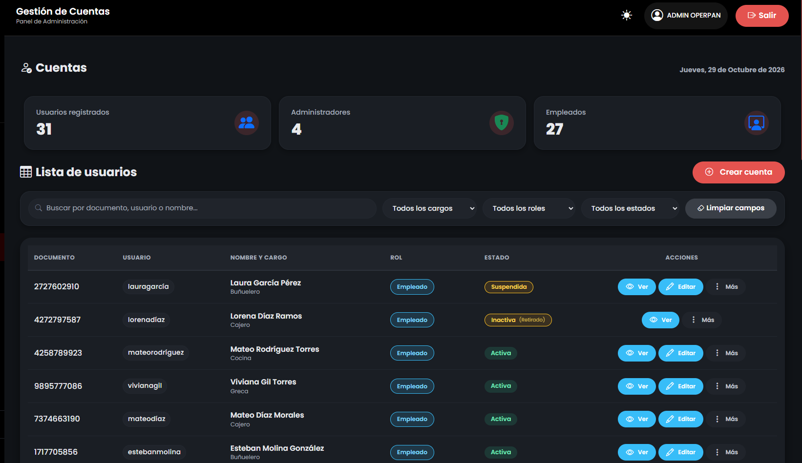
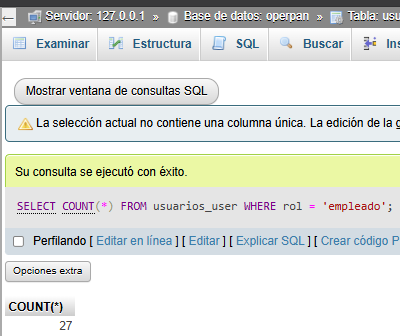

# Reporte de Prueba QA: CUEN-001

**ID del Caso:** CUEN-001
**Módulo:** Cuentas
**Área Funcional:** Administrador / Carga del panel
**Tipo de Prueba:** Caja Blanca (Camino Básico)
**Fecha de Ejecución:** 29-10-2026
**Entorno de Pruebas:** Local (Django + MySQL/XAMPP)
**Dependencias:** Ninguna

---

## 1. Objetivo de la Prueba
Verificar el flujo principal de acceso al módulo de gestión de cuentas por parte del Administrador, asegurando la correcta carga de indicadores y listados.

## 2. Precondiciones
*   Sesión iniciada como Administrador.
*   Base de datos con usuarios registrados.

## 3. Pasos Ejecutados
1. Entrar al módulo "Cuentas" desde el menú lateral.
2. Observar los indicadores superiores (Registrados, Admins, Empleados).
3. Revisar la tabla de usuarios y sus estados.
4. Validar los números con consultas SQL en la base de datos por medio de la ejecución de XAMP.

## 4. Resultado Esperado
El sistema debe mostrar el panel con los contadores numéricos correctos y el listado de usuarios sin errores de carga.

## 5. Resultado Obtenido (Evidencia Frontend)
*[Inserta tu captura de pantalla del panel de Cuentas]*

**Descripción del resultado visual:**
El panel muestra 31 usuarios registrados, 4 administradores y 27 empleados. La tabla lista a los usuarios con sus roles y estados visuales (Activa, Suspendida, Inactiva).

## 6. Procedimiento Especial (Validación en Base de Datos)

Se ejecutaron consultas `SELECT COUNT(*)` filtrando por roles en la tabla de usuarios.

**Resultado de la validación:**
Los resultados de la base de datos coinciden exactamente con los mostrados en la interfaz (31 total, 4 admins, 27 empleados).

## 7. Conclusión del QA
**Estado de la Prueba:** `APROBADA` ✅

**Observaciones:**
Carga del panel exitosa. La consistencia de datos entre el Frontend y el Backend está garantizada. El diseño de la tabla es claro y los estados se diferencian por colores, mejorando la UX.

---
*Documentación generada por: Andrea Herrera (QA)*