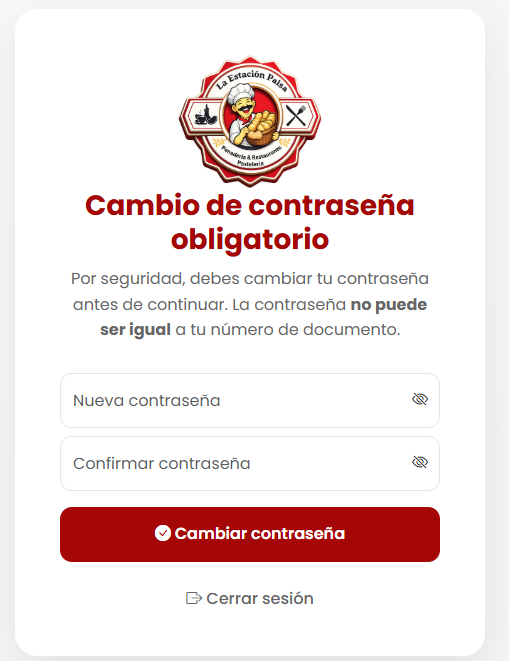

## 3. Pasos Ejecutados
...
6. Iniciar sesión con las credenciales enviadas al correo.
7. Verificar la pantalla de "Cambio de contraseña obligatorio".
8. Intentar usar el documento como nueva contraseña (debe fallar).
9. Ingresar una contraseña nueva y segura, y confirmar el acceso al sistema.

## 5. Resultado Obtenido (Evidencia Frontend)
...

**Descripción del resultado visual:**
Al ingresar por primera vez con la contraseña por defecto, el sistema bloquea el acceso al panel y muestra una pantalla de "Cambio de contraseña obligatorio". La interfaz advierte claramente que la nueva clave no puede ser igual al documento. Tras ingresar una clave válida, el usuario accede correctamente.