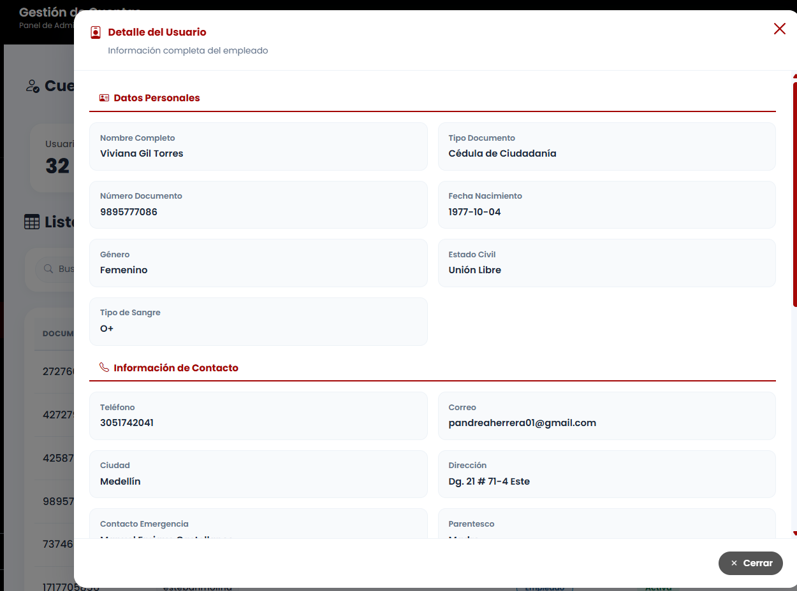

# Reporte de Prueba QA: CUEN-004

**ID del Caso:** CUEN-004
**Módulo:** Cuentas
**Área Funcional:** Creación / Validación de formulario
**Tipo de Prueba:** Caja Negra (Valores Límite)
**Fecha de Ejecución:** 29-10-2026
**Entorno de Pruebas:** Local (Django + MySQL/XAMPP)
**Dependencias:** CUEN-002

---

## 1. Objetivo de la Prueba
Verificar que el sistema rechace la creación de una cuenta cuando uno o más campos obligatorios se encuentren vacíos, impidiendo el guardado parcial de información.

## 2. Precondiciones
*   Sesión iniciada como Administrador.
*   Formulario de creación de cuenta accesible.

## 3. Pasos Ejecutados
1. Abrir el modal de "Crear cuenta".
2. Llenar los datos del formulario, pero dejar vacío el campo "Primer Nombre".
3. Intentar guardar el usuario.
4. Repetir el proceso dejando vacío el campo "Número de Documento".
5. Repetir el proceso dejando vacío un campo de la sección laboral (ej. EPS).
6. Verificar que no se cree ningún registro parcial en la tabla.

## 4. Resultado Esperado
El sistema debe frenar el guardado, resaltar los campos vacíos con mensajes de error específicos y no generar registros incompletos.

## 5. Resultado Obtenido (Evidencia Frontend)

**Descripción del resultado visual:**
Al intentar guardar con campos vacíos, el sistema bloquea la acción inmediatamente. Se observa el mensaje de validación (ej. "Por favor, complete este campo" o resaltado en rojo). 

## 6. Conclusión del QA
**Estado de la Prueba:** `APROBADA` ✅

**Observaciones:**
Validación efectiva. El sistema aplica doble protección (Frontend con atributos HTML y Backend con validación de Django). Se garantiza la integridad de la base de datos al no permitir registros parciales.

---
*Documentación generada por: Andrea Herrera (QA)*