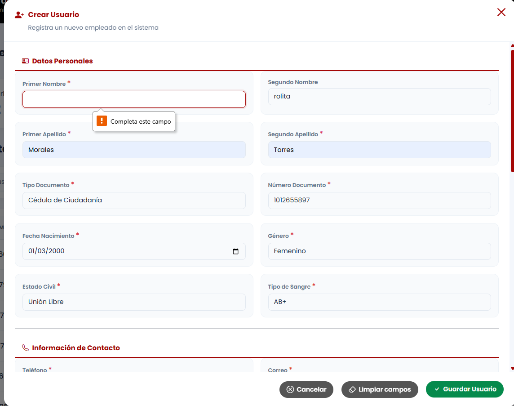
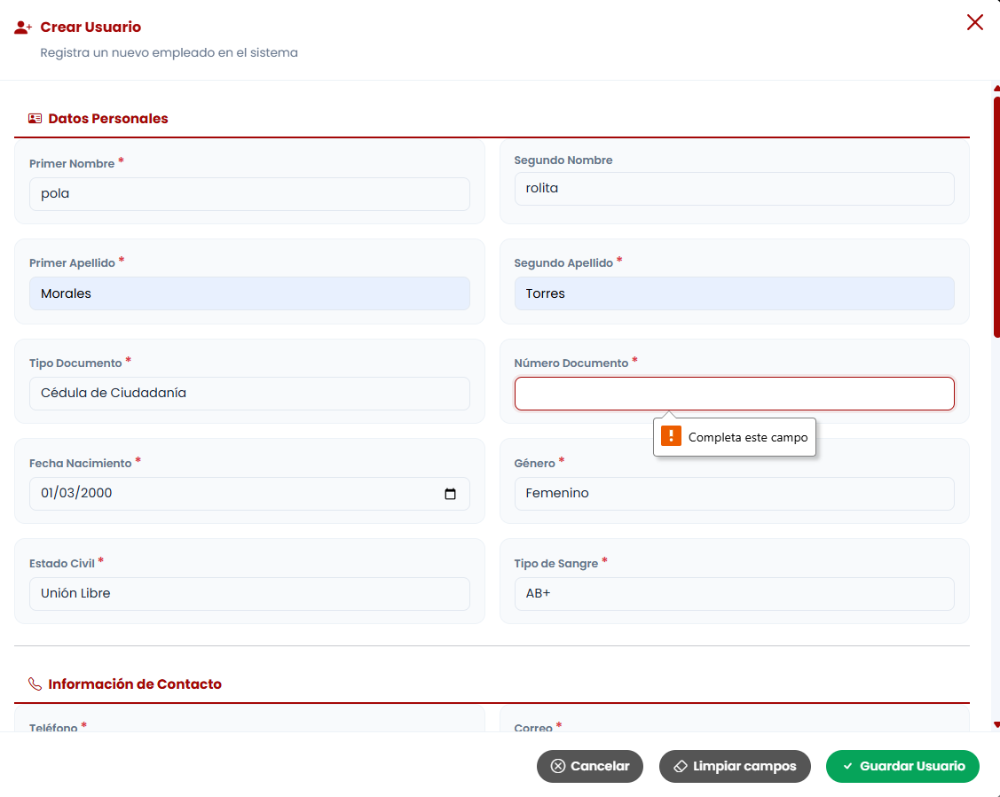

# Reporte de Prueba QA: CUEN-004

**ID del Caso:** CUEN-004
**Módulo:** Cuentas
**Área Funcional:** Creación / Validación de formulario
**Tipo de Prueba:** Caja Negra (Valores Límite)
**Fecha de Ejecución:** 29-10-2026
**Entorno de Pruebas:** Local (Django + MySQL/XAMPP)
**Dependencias:** CUEN-002

---

## 1. Objetivo de la Prueba
Verificar que el sistema rechace la creación de una cuenta cuando uno o más campos obligatorios se encuentren vacíos, impidiendo el guardado parcial de información.

## 2. Precondiciones
*   Sesión iniciada como Administrador.
*   Formulario de creación de cuenta accesible.

## 3. Pasos Ejecutados
1. Abrir el modal de "Crear cuenta".
2. Llenar los datos del formulario, pero dejar vacío el campo "Primer Nombre".
3. Intentar guardar el usuario.
4. Repetir el proceso dejando vacío el campo "Número de Documento".
5. Verificar que no se cree ningún registro parcial en la tabla.

## 4. Resultado Esperado
El sistema debe frenar el guardado, resaltar los campos vacíos con mensajes de error específicos y no generar registros incompletos.

## 5. Resultado Obtenido (Evidencia Frontend)

**Descripción del resultado visual:**
Al intentar guardar con el "Primer Nombre" o el "Número de Documento" vacíos, el sistema bloquea la acción inmediatamente. El navegador resalta el campo en rojo y despliega un mensaje nativo indicando "Completa este campo". 

## 6. Conclusión del QA
**Estado de la Prueba:** `APROBADA` ✅

**Observaciones:**
Validación efectiva a nivel de Frontend (HTML5 `required`). El sistema impide que peticiones incompletas lleguen al servidor, garantizando la integridad de la base de datos desde el primer filtro.

---
*Documentación generada por: Andrea Herrera (QA)*