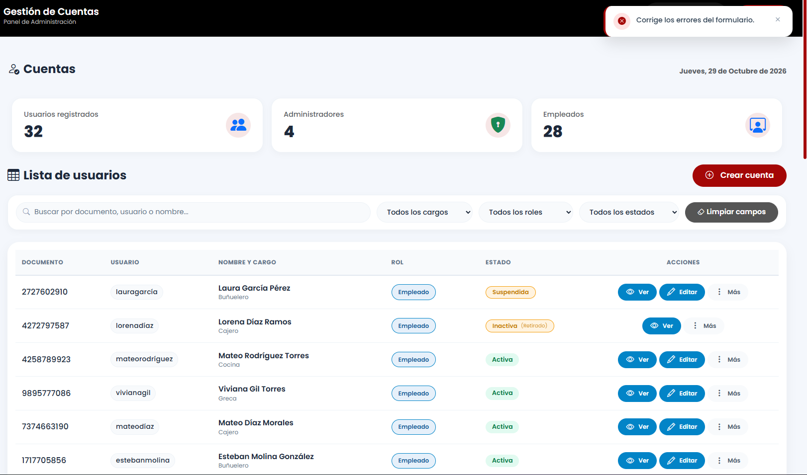

# Reporte de Prueba QA: CUEN-005

**ID del Caso:** CUEN-005
**Módulo:** Cuentas
**Área Funcional:** Creación / Unicidad de documento
**Tipo de Prueba:** Caja Negra (Valores Límite)
**Fecha de Ejecución:** 29-10-2026
**Entorno de Pruebas:** Local (Django + MySQL/XAMPP)
**Dependencias:** CUEN-002

---

## 1. Objetivo de la Prueba
Verificar que el sistema rechace la creación de una cuenta cuando se ingrese un número de documento que ya pertenece a otro empleado.

## 2. Precondiciones
*   Empleado ya registrado en el sistema (Viviana Gil - Doc: 9895777086).
*   Formulario de creación accesible.

## 3. Pasos Ejecutados
1. Abrir el modal de "Crear cuenta".
2. Llenar los datos del formulario.
3. En el campo "Número de Documento", ingresar el documento de Viviana (`9895777086`).
4. Intentar guardar.
5. Verificar el mensaje mostrado en pantalla.
6. Consultar la base de datos para comprobar si el duplicado se insertó.

## 4. Resultado Esperado
El sistema debe rechazar la creación y mostrar un mensaje específico: "Este número de documento ya está registrado".

## 5. Resultado Obtenido (Evidencia Frontend)

**Descripción del resultado visual:**
El sistema frena el guardado y muestra un Toast genérico en la parte superior derecha. No se genera un segundo perfil en la base de datos (comprobado con SQL).

## 6. Conclusión del QA
**Estado de la Prueba:** `FALLIDA` (Bug de UX)

**Observaciones:**
**Bug detectado:** El backend protege correctamente la integridad de los datos impidiendo duplicados (Excelente), pero el Frontend no maneja el error de forma amigable. El mensaje "Corregir los errores del formulario" es ambiguo. Se recomienda añadir una validación en el `forms.py` de Django que devuelva un mensaje claro al usuario: "El número de documento ya está en uso".

---
*Documentación generada por: Andrea Herrera (QA)*