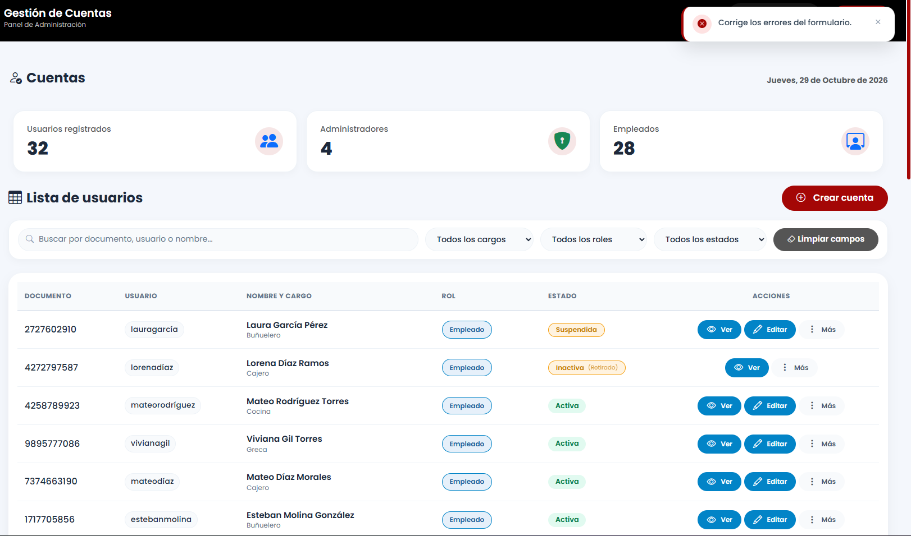
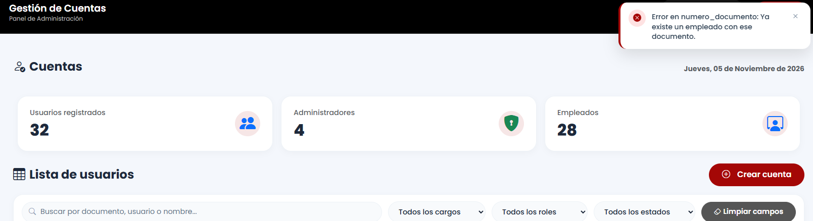

# Reporte de Prueba QA: CUEN-005

**ID del Caso:** CUEN-005
**Módulo:** Cuentas
**Área Funcional:** Creación / Unicidad de documento
**Tipo de Prueba:** Caja Negra (Valores Límite)
**Fecha de Ejecución:** 29-10-2026
**Entorno de Pruebas:** Local (Django + MySQL/XAMPP)
**Dependencias:** CUEN-002

---

## 1. Objetivo de la Prueba
Verificar que el sistema rechace la creación de una cuenta cuando se ingrese un número de documento que ya pertenece a otro empleado.

## 2. Pasos Ejecutados
1. Abrir el modal de "Crear cuenta".
2. Llenar los datos del formulario.
3. En el campo "Número de Documento", ingresar el documento de Viviana (`9895777086`).
4. Intentar guardar.

## 3. Resultado Obtenido (Pre-Fix)

## 4. Conclusión del QA
**Estado Final:** `APROBADA` ✅ (Tras Retest)

---

## 5. Historial del Bug y Retest (Post-Fix)

**Fecha del Bug:** 29-10-2026
**Fecha del Retest:** 05-11-2026

**Descripción del Bug (UX):** 
El sistema impedía correctamente la creación de documentos duplicados a nivel de base de datos, pero la interfaz no notificaba al usuario la causa específica del error.

**Solución Implementada (Dev):**
Se modificó la vista `user_list_create` en `views.py`. Se reemplazó el mensaje de error genérico por un bucle que extrae y muestra los errores específicos de validación de los formularios (`user_form.errors` y `perfil_form.errors`).

**Resultado del Retest:**

El sistema ahora muestra un mensaje claro: **"Error en numero_documento: Ya existe un empleado con ese documento."** El usuario comprende de inmediato qué falló. La integridad de los datos se mantiene y la experiencia de usuario (UX) ha sido optimizada.

---
*Documentación generada por: Andrea Herrera (QA)*