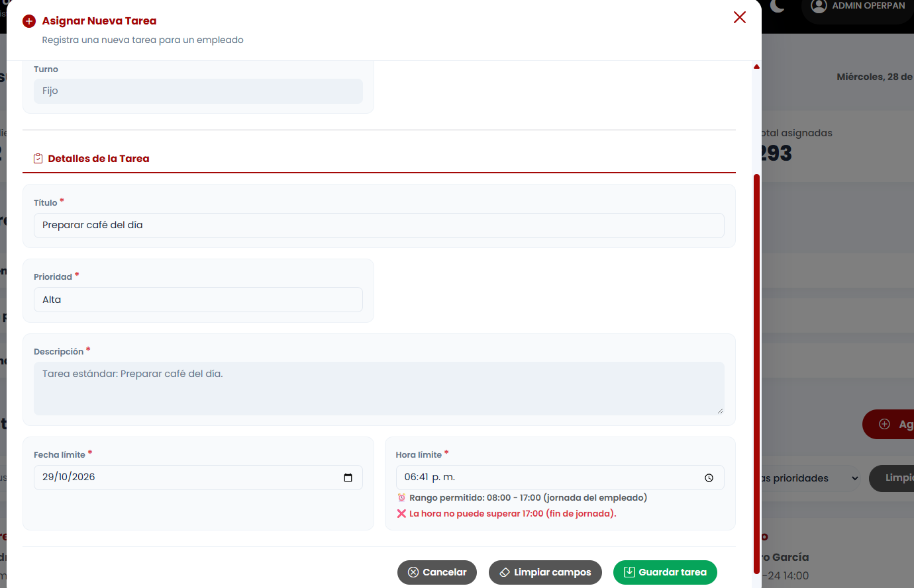
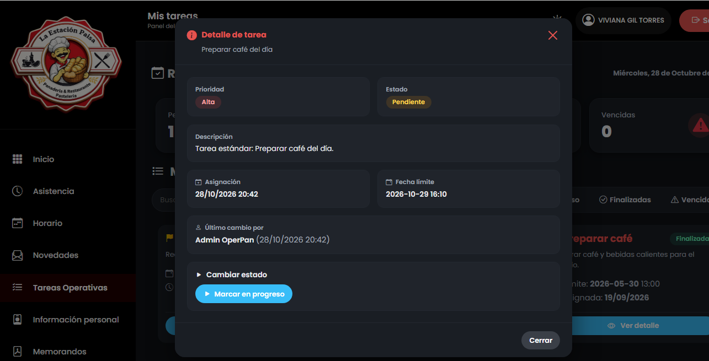

# Reporte de Prueba QA: TARE-002

**ID del Caso:** TARE-002
**Módulo:** Tareas
**Área Funcional:** Creación / Administrador
**Tipo de Prueba:** Caja Blanca (Camino Básico)
**Fecha de Ejecución:** 28-10-2026
**Entorno de Pruebas:** Local (Django + MySQL/XAMPP)
**Dependencias:** TARE-001

---

## 1. Objetivo de la Prueba
Verificar el flujo principal de asignación de una nueva tarea a un empleado desde el rol de Administrador, validando la autocompletación de datos y las reglas de negocio (jornada laboral).

## 2. Precondiciones
*   Sesión iniciada como Administrador.
*   Empleado activo con horario vigente (Viviana Gil - Turno 08:00 a 17:00).

## 3. Pasos Ejecutados
1. Entrar al módulo "Tareas Operativas" con el rol de Administrador.
2. Hacer clic en el botón "Agregar tarea".
3. Seleccionar a la empleada "Viviana Gil Torres". El sistema carga su turno (Fijo).
4. En "Detalles de la Tarea", seleccionar el título "Preparar café del día".
5. Verificar que la Prioridad ("Alta") y Descripción se autocompleten.
6. **Prueba de límites:** Intentar guardar con hora límite "06:41 p.m." (Fuera de la jornada).
7. **Happy Path:** Corregir la hora límite a las "16:10" (Dentro de la jornada) y guardar.
8. Cerrar sesión de Administrador e iniciar sesión como la empleada (Viviana) para verificar la recepción de la tarea.

## 4. Resultado Esperado
El sistema debe autocompletar los detalles del catálogo, bloquear horas fuera de la jornada y guardar la tarea asignándola al empleado con estado "Pendiente", reflejándose en su panel.

## 5. Resultado Obtenido (Evidencia Frontend)

**Descripción del resultado visual:**
El sistema autocompletó la prioridad y la descripción correctamente. La validación de jornada funcionó a la perfección, mostrando una alerta en rojo al intentar poner una hora fuera del turno de la empleada. Al ingresar una hora válida y guardar, la tarea apareció inmediatamente en el panel de la empleada (Viviana) con el contador de "Pendientes: 1".

## 6. Procedimiento Especial (Validación en Base de Datos)
Se realizó una consulta SQL a la tabla `tareas_task` para verificar el registro de la nueva tarea y la asignación del ID de la empleada.
*[Inserta aquí tu captura de la consulta SQL en phpMyAdmin]*

**Resultado de la validación:**
La tarea se insertó correctamente en la base de datos con el estado `PENDIENTE`, vinculada al ID de la empleada y con la hora límite exacta (16:10) respetando las reglas del backend.

## 7. Conclusión del QA
**Estado de la Prueba:** `APROBADA` ✅

**Observaciones:**
Prueba End-to-End (E2E) exitosa. Se validó la integración completa: el Administrador crea la tarea y el Empleado la recibe en su propio panel. El sistema cuenta con excelentes validaciones de lógica de negocio (turnos) que impiden errores humanos al asignar tareas, y los contadores del empleado se actualizan dinámicamente.

---
*Documentación generada por: Andrea Herrera (QA)*