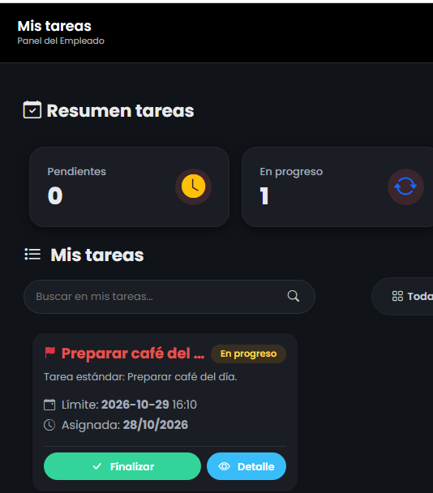

# Reporte de Prueba QA: TARE-003

**ID del Caso:** TARE-003
**Módulo:** Tareas
**Área Funcional:** Gestión de tareas / Empleado
**Tipo de Prueba:** Caja Blanca (Camino Básico)
**Fecha de Ejecución:** 29-10-2026
**Entorno de Pruebas:** Local (Django + MySQL/XAMPP)
**Dependencias:** TARE-002

---

## 1. Objetivo de la Prueba
Verificar el flujo principal de un empleado al iniciar y finalizar una tarea asignada, validando las restricciones del flujo de trabajo (no finalizar sin iniciar) y el registro de evidencias.

## 2. Precondiciones
*   Tarea en estado "Pendiente" asignada a la empleada Viviana Gil (creada en TARE-002).

## 3. Pasos Ejecutados
1. Iniciar sesión como Empleado (Viviana).
2. Entrar a "Mis tareas" y abrir el detalle de la tarea "Preparar café del día".
3. **Prueba de límites:** Verificar la ausencia del botón "Finalizar" estando en estado Pendiente.
4. Hacer clic en "Marcar en progreso".
5. Hacer clic en "Finalizar" y adjuntar evidencia (opcional).
6. Verificar el cambio de estado en la base de datos.

## 4. Resultado Esperado
El sistema debe impedir la finalización directa, exigir el paso a "En progreso" y registrar la fecha de finalización en la base de datos.

## 5. Resultado Obtenido (Evidencia Frontend)

**Descripción del resultado visual:**
El sistema oculta inteligentemente el botón de finalizar en estado "Pendiente". Al iniciar la tarea, el flujo permite finalizarla, actualizando los contadores visuales correctamente.

## 6. Procedimiento Especial (Validación en Base de Datos)
Se ejecutó la siguiente consulta SQL:
`SELECT id, titulo, estado, fecha_finalizacion FROM tareas_task WHERE titulo = 'Preparar café del día';`

**Resultado de la validación:**
El registro en la base de datos muestra el estado `FINALIZADA` y la columna `fecha_finalizacion` contiene el timestamp exacto del cierre de la tarea (`2026-10-29 02:30:17`), confirmando la persistencia del cambio.

## 7. Conclusión del QA
**Estado de la Prueba:** `APROBADA` ✅

**Observaciones:**
Flujo de trabajo (Workflow) altamente seguro. Se destaca la buena práctica de UX de ocultar acciones no permitidas (botón finalizar) en lugar de mostrar errores. El Backend asegura la trazabilidad del tiempo de ejecución.

---
*Documentación generada por: Andrea Herrera (QA)*