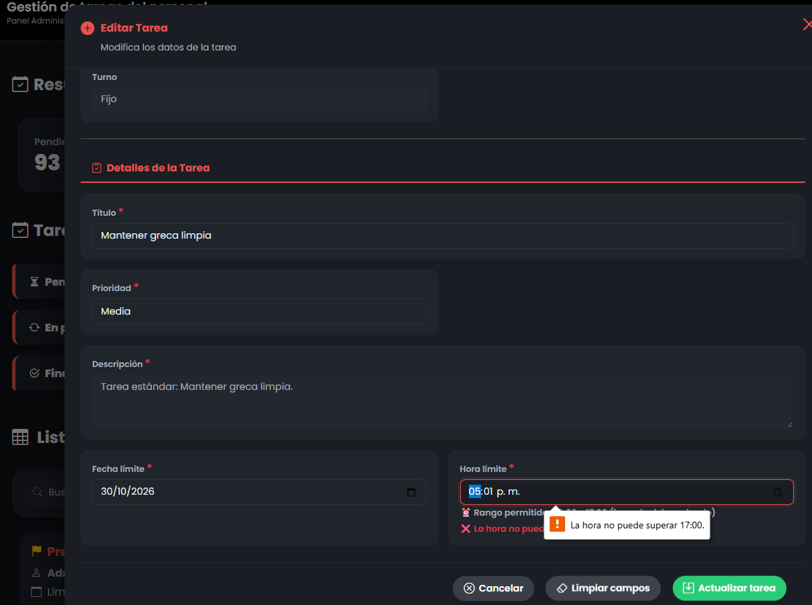

# Reporte de Prueba QA: TARE-004

**ID del Caso:** TARE-004
**Módulo:** Tareas
**Área Funcional:** Creación / Validación de hora límite
**Tipo de Prueba:** Caja Negra (Valores Límite)
**Fecha de Ejecución:** 29-10-2026
**Entorno de Pruebas:** Local (Django + MySQL/XAMPP)
**Dependencias:** TARE-002

---

## 1. Objetivo de la Prueba
Verificar que el sistema rechace la creación o edición de una tarea cuando la hora límite esté fuera del rango de jornada del empleado, evaluando específicamente los valores límite (inicio y fin exactos).

## 2. Precondiciones
*   Sesión iniciada como Administrador.
*   Empleada (Viviana Gil) con jornada laboral establecida de 08:00 a 17:00.

## 3. Pasos Ejecutados
1. Abrir el modal de "Agregar tarea" y seleccionar a la empleada.
2. **Límite Inferior (Rechazo):** Ingresar hora límite `07:59`. Guardar.
3. **Límite Inferior (Aceptación):** Ingresar hora límite `08:00`. Guardar.
4. **Límite Superior (Aceptación):** Editar la tarea e ingresar hora límite `17:00`. Guardar.
5. **Límite Superior (Rechazo):** Editar la tarea e ingresar hora límite `17:01`. Guardar.

## 4. Resultado Esperado
El sistema debe aceptar las horas exactas de entrada (08:00) y salida (17:00), y debe rechazar cualquier hora anterior a las 08:00 o posterior a las 17:00.

## 5. Resultado Obtenido (Evidencia Frontend)

**Descripción del resultado visual:**
El sistema bloqueó correctamente las 07:59 (mostrando "❌ La hora no puede ser antes de 08:00") y las 17:01 (mostrando "❌ La hora no puede superar 17:00" y la alerta flotante). Permitió guardar con éxito las horas límite exactas de 08:00 y 17:00.

## 6. Conclusión del QA
**Estado de la Prueba:** `APROBADA` ✅

**Observaciones:**
Prueba de Valores Límite exitosa. La lógica booleana en el backend (Django) está correctamente implementada para proteger la regla de negocio de la jornada laboral. No se detectaron desbordamientos de tiempo ni errores lógicos en los extremos.

---
*Documentación generada por: Andrea Herrera (QA)*