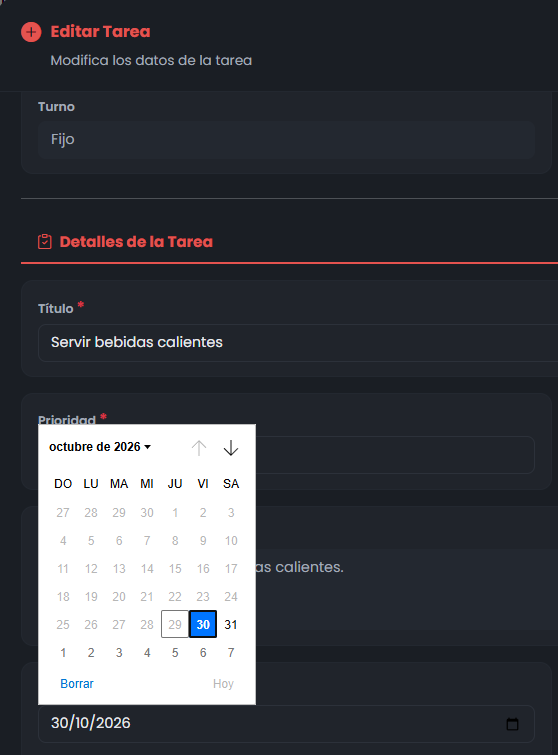

# Reporte de Prueba QA: TARE-005

**ID del Caso:** TARE-005
**Módulo:** Tareas
**Área Funcional:** Creación / Validación de fecha límite
**Tipo de Prueba:** Caja Negra (Valores Límite)
**Fecha de Ejecución:** 29-10-2026
**Entorno de Pruebas:** Local (Django + MySQL/XAMPP)
**Dependencias:** TARE-002

---

## 1. Objetivo de la Prueba
Verificar el comportamiento del sistema al asignar una tarea con fecha límite anterior a la fecha actual, comprobando la correcta aplicación de la regla de negocio ("hoy para mañana").

## 2. Precondiciones
*   Sesión iniciada como Administrador.
*   Formulario de creación/edición de tareas accesible.

## 3. Pasos Ejecutados
1. Abrir el modal de "Agregar tarea" o "Editar Tarea".
2. Intentar seleccionar la fecha de ayer (28/10/2026).
3. Intentar seleccionar la fecha de hoy (29/10/2026).
4. Seleccionar la fecha de mañana (30/10/2026) e intentar guardar.

## 4. Resultado Esperado
El sistema debe impedir la selección de fechas pasadas y del día actual, exigiendo que la tarea sea agendada con un mínimo de un día de anticipación (a partir de mañana).

## 5. Resultado Obtenido (Evidencia Frontend)

**Descripción del resultado visual:**
El calendario del navegador bloquea correctamente la selección de los días 28 y 29. Al seleccionar la fecha de mañana (30/10/2026), el sistema valida correctamente y permite proceder con el guardado de la tarea.

## 6. Conclusión del QA
**Estado de la Prueba:** `APROBADA` ✅

**Observaciones:**
La validación de fechas es robusta y ofrece una excelente Experiencia de Usuario (UX). Al restringir la selección desde el componente de UI, se evita que el usuario llegue a un mensaje de error en el backend. El requerimiento original fue ajustado para reflejar la regla real de negocio (agendamiento mínimo para el día siguiente).

---
*Documentación generada por: Andrea Herrera (QA)*