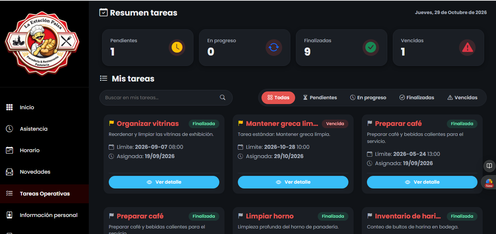

# Reporte de Prueba QA: TARE-006

**ID del Caso:** TARE-006
**Módulo:** Tareas
**Área Funcional:** Estado / Clasificación de vencimiento
**Tipo de Prueba:** Caja Negra (Prueba de Sistema)
**Fecha de Ejecución:** 29-10-2026
**Entorno de Pruebas:** Local (Django + MySQL/XAMPP)
**Dependencias:** TARE-002

---

## 1. Objetivo de la Prueba
Verificar que una tarea no finalizada después de su fecha y hora límite se marque automáticamente como "Vencida" y restrinja las acciones del empleado.

## 2. Precondiciones
*   Tarea existente en estado "Pendiente" (Mantener greca limpia).
*   Fecha límite modificada previamente en la base de datos a una fecha pasada (28/10/2026).

## 3. Pasos Ejecutados
1. Iniciar sesión como Empleado (Viviana).
2. Entrar a "Mis tareas".
3. Observar el resumen superior y la tarjeta de la tarea modificada.
4. Hacer clic en "Ver detalle" de la tarea vencida.

## 4. Resultado Esperado
La tarea debe aparecer con la etiqueta "Vencida", el contador de vencidas debe aumentar, y no debe permitir modificaciones (como iniciar o finalizar) desde la vista del empleado.

## 5. Resultado Obtenido (Evidencia Frontend)

**Descripción del resultado visual:**
El sistema refleja correctamente el estado "Vencida" en la tarjeta de la tarea y actualiza el contador superior a 1. Se verificó que el botón de acción "Iniciar" desaparece, dejando únicamente la opción "Ver detalle", impidiendo así la modificación de la tarea.

## 6. Conclusión del QA
**Estado de la Prueba:** `APROBADA` ✅

**Observaciones:**
Lógica de vencimiento robusta. El sistema aplica restricciones visuales (ocultar botón de inicio) y lógicas (cambio de estado visual) basadas en el tiempo. Excelente control para evitar que se registren avances en tareas fuera de plazo.

---
*Documentación generada por: Andrea Herrera (QA)*