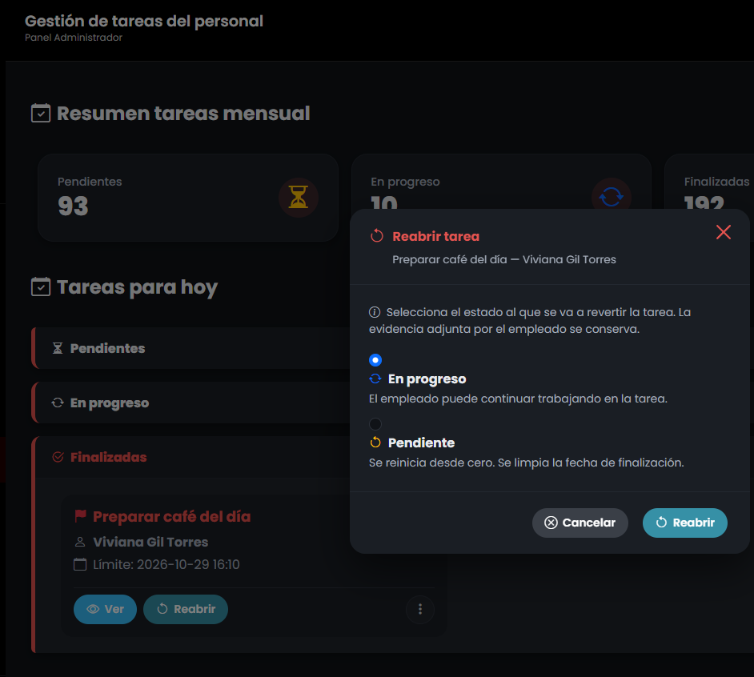
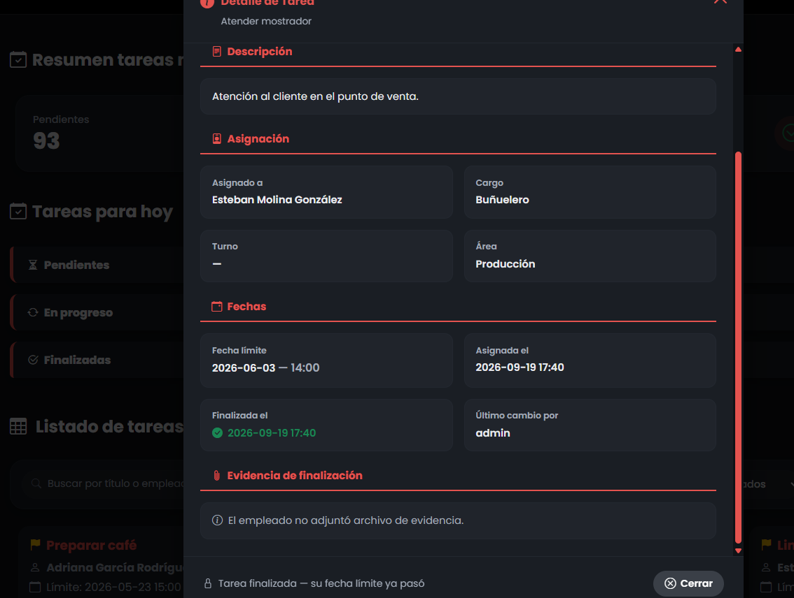

## 5. Resultado Obtenido (Evidencia Frontend)

**Descripción del resultado visual:**
Para la tarea reciente, el botón "Reabrir" se mostró y ejecutó exitosamente. Para la tarea finalizada hace meses (junio), el sistema ocultó el botón de reapertura y mostró el mensaje informativo al pie: "Tarea finalizada — su fecha límite ya pasó", bloqueando la acción de forma elegante.

## 7. Conclusión del QA
**Estado de la Prueba:** `APROBADA` ✅

**Observaciones:**
Lógica de reapertura robusta. Se destaca la buena práctica de UX/UI: el sistema previene el error ocultando el botón de acción (Reabrir) cuando la regla de negocio (margen de 2 días) no se cumple, en lugar de permitir el clic y arrojar un error en el servidor.