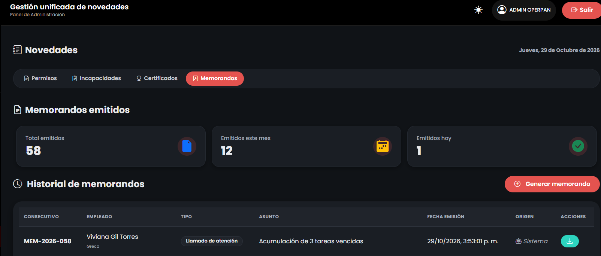

# Reporte de Prueba QA: TARE-008

**ID del Caso:** TARE-008
**Módulo:** Tareas / Memorandos
**Área Funcional:** Generación automática de memorandos
**Tipo de Prueba:** Caja Negra (Prueba de Sistema)
**Fecha de Ejecución:** 29-10-2026
**Entorno de Pruebas:** Local (Django + MySQL/XAMPP)
**Dependencias:** TARE-006

---

## 1. Objetivo de la Prueba
Verificar que el sistema genere automáticamente un memorando cuando un empleado acumule 3 tareas vencidas sin finalizar, validando el consecutivo y la integridad de los datos.

## 2. Precondiciones
*   Empleada (Viviana) con 3 o más tareas vencidas en la base de datos.
*   Sesión iniciada como Administrador.

## 3. Pasos Ejecutados
1. Preparar la base de datos con 4 tareas vencidas para Viviana.
2. Navegar al módulo de "Novedades" -> Pestaña "Memorandos".
3. Verificar la generación automática del memorando y sus detalles.
4. Revisar la columna "Origen" y el consecutivo.

## 4. Resultado Esperado
El sistema debe generar el memorando automáticamente al detectar el umbral de 3 tareas vencidas, con su respectivo consecutivo y marcando el origen como "Sistema".

## 5. Resultado Obtenido (Evidencia Frontend)

**Descripción del resultado visual:**
El sistema registra "1" memorando emitido hoy. En la tabla se observa el registro `MEM-2026-058` para Viviana Gil Torres, con el asunto "Acumulación de 3 tareas vencidas", fecha exacta de emisión y origen "Sistema". El sistema ignoró la cuarta tarea (solo contó el umbral de 3) y generó un solo memorando.

## 6. Conclusión del QA
**Estado de la Prueba:** `APROBADA` ✅

**Observaciones:**
Automatización robusta. El backend procesa correctamente las reglas de negocio (umbral de 3 tareas vencidas) sin requerir intervención humana, manteniendo la secuencia de radicados y la trazabilidad del origen.

---
*Documentación generada por: Andrea Herrera (QA)*