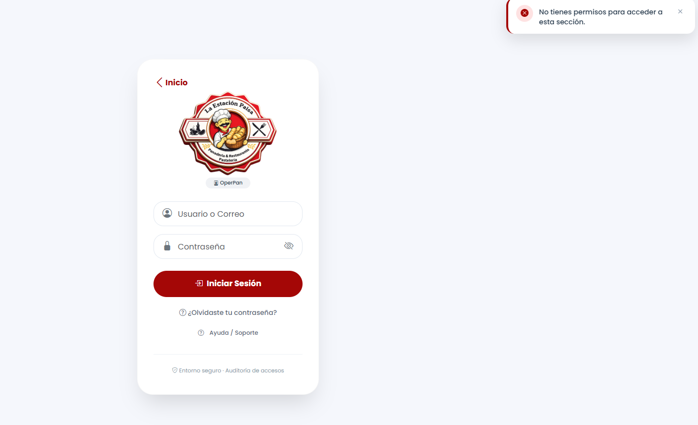

# Reporte de Prueba QA: TARE-009

**ID del Caso:** TARE-009
**Módulo:** Tareas
**Área Funcional:** Seguridad y Autorización
**Tipo de Prueba:** Caja Negra (Control de Acceso)
**Fecha de Ejecución:** 29-10-2026
**Entorno de Pruebas:** Local (Django + MySQL/XAMPP)
**Dependencias:** TARE-001, TARE-003

---

## 1. Objetivo de la Prueba
Verificar que un usuario con rol de Empleado no pueda acceder al panel administrativo de tareas mediante la manipulación directa de la URL.

## 2. Precondiciones
*   Sesión iniciada como Empleado (Viviana).
*   Conocer la URL del módulo administrativo de tareas.

## 3. Pasos Ejecutados
1. Iniciar sesión como Administrador y copiar la URL del módulo de tareas (`/tareas/admin/tareas/`).
2. Cerrar sesión e iniciar sesión como Empleada (Viviana).
3. Pegar la URL del administrador en la barra de direcciones del navegador.
4. Presionar Enter y observar el resultado.

## 4. Resultado Esperado
El sistema debe denegar el acceso al empleado (Error 403, redirección o cierre de sesión), manteniéndolo en sus vistas autorizadas.

## 5. Resultado Obtenido (Evidencia Frontend)

**Descripción del resultado visual:**
Al intentar acceder a la URL administrativa, el sistema redirige inmediatamente al Login y despliega una notificación roja en la esquina superior derecha indicando: "No tienes permisos para acceder a esta sección".

## 6. Conclusión del QA
**Estado de la Prueba:** `APROBADA` ✅

**Observaciones:**
Seguridad robusta y control de acceso estricto. La aplicación no solo oculta los enlaces en la interfaz para el empleado, sino que protege el endpoint a nivel de Backend. El sistema es inmune a ataques de escalada de privilegios (Privilege Escalation).

---
*Documentación generada por: Andrea Herrera (QA)*